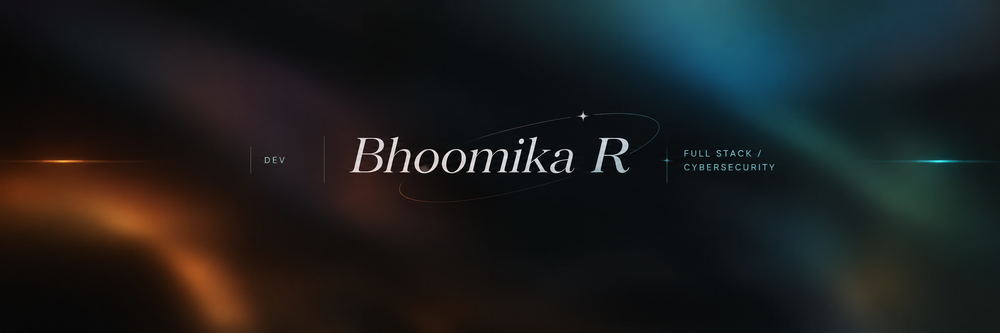

  

## About Me

Computer Science student at BMS Institute of Technology & Management, driven by a simple question: how do we build technology that actually makes people’s lives better?

My focus spans full-stack development, software engineering, cybersecurity, and technology management — not as separate interests, but as different lenses on the same goal: building systems that are functional, secure, and genuinely useful. I’m drawn to the full lifecycle of a product: designing it, engineering it, securing it, and understanding the strategy behind why it matters.
Always experimenting, always shipping something new — because the best way to understand technology is to build with it.

## Languages and activity

  

## Contacts

